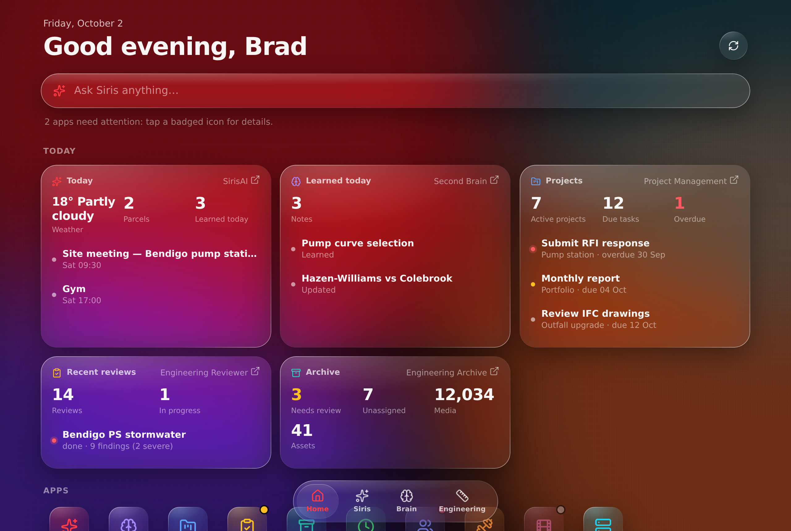

# SirisOS

SirisOS is the home screen for the Siris family of self-hosted apps. It is
a Liquid Glass web app (an installable PWA) that shows every app as a live
tile and puts their data on one screen as widgets. SirisAI is built in as
the system assistant and Siris as the notes layer. SirisOS also
keeps the engineering tools that no other app owns.

**Complement, not replace.** SirisOS does not rebuild what another app
already does well. SirisAI owns the assistant, memory and home
integrations. Siris owns notes and knowledge. SirisOS links to
all of them, monitors them and surfaces their data. See [ADR 106](docs/adr/106-sirisos-hub.md).

Every morning a **daily brief** opens by itself until 9 am, or until you
close it. It shows your day, the news picked from Siris
interests, and anything that needs a look
([ADR 108](docs/adr/108-daily-brief.md)).

Press **⌘K** (or **Ctrl+K**, or the search button) to **search everything**:
apps, widgets, links, Siris notes, SirisAI chats, the Archive,
the Reviewer and the engineering library, all in one list
([ADR 109](docs/adr/109-search-everything.md)).

Everything that needs a look, from every app, lands in one **inbox**:
SirisAI's alerts and approvals (Lock down, Approve, Create automation...)
next to apps that are down and overdue tasks, live, on Home and at
`/inbox`. Home also runs SirisAI's protocols (with undo), shows the
cameras with a "What's there?", and the car and power prices. SirisAI, in
turn, can search the standards library, run the calculators and ask
SirisHydro ([ADR 110](docs/adr/110-sirisai-integration.md)).
The **Career** tab tracks the path to Chartered (CPEng), the National
Engineering Register and registration in Victoria. It maps evidence to the
16 Stage 2 competencies, keeps goals and next steps, and shows CPD against
the 150-hour requirement. CPD is imported from Engineers Australia's own
export, so it's only ever logged there ([ADR 111](docs/adr/111-career.md)).

The **Terminal** opens a shell on a machine at home over SSH. It's for
reaching home from work over Tailscale or a VPN. Every session needs a
fresh code from an authenticator app, and sessions close by themselves
([ADR 113](docs/adr/113-terminal.md)).

**Version 1.0** ([release notes](docs/releases/1.0.md)). Every change bumps
the version by 0.01 or 0.1 and merges to main once CI is green; a version
bump tags and publishes the release ([docs/releases.md](docs/releases.md)).

This README is the project handover and [`docs/roadmap.md`](docs/roadmap.md)
is the checklist. Update both whenever scope or status changes. The
pre-hub README and roadmap are kept in [`docs/history/`](docs/history/).



## Architecture

```text
 iPhone / browser ── PWA (apps/web: React + TS, Liquid Glass)
        │  one origin, JWT
        ▼
 sirisos container :8094 ── nginx ──► static PWA
                              └─► /api ─► FastAPI (apps/backend)
                                          ├─ hub gateway (connectors)
                                          │    ├─ SirisAI + Siris  (bearer key)
                                          │    ├─ Engineering Reviewer :8082
                                          │    ├─ Engineering Archive :8091 (X-API-Key)
                                          │    ├─ SirisDrone :8096        (library + exports)
                                          │    └─ SirisLearn :8100        (courses + streaks)
                                          └─ engineering module
                                               SirisHydro · calculators · Standards · Projects
```

The browser only talks to SirisOS. Each app's credentials stay on the
server, and every connector reports its own state (`ok`, `degraded`,
`down` or `unconfigured`), so a dead app blanks its own tile and nothing
else.

## Deploy

```bash
git pull
make up          # builds the PWA + API image and starts the stack on :8094
```

Copy `.env.example` to `.env` and fill in the connector section. Any app
left blank shows as "not configured" and is otherwise ignored. Then run
`make hub-check` to test every connection from inside the container. The
first-time move to the hub build is covered step by step in
[`docs/deploy-hub.md`](docs/deploy-hub.md).

| Variable | Purpose |
| --- | --- |
| `SIRISOS_PORT` | Host port (default `8094`; `6464` is now dad-joke-of-the-day) |
| `SIRISAI_URL`, `SIRISAI_API_KEY`, `SIRISAI_PUBLIC_URL` | Assistant, HUD and Siris. `SIRISAI_URL` is how the container reaches SirisAI. `SIRISAI_PUBLIC_URL` is the link your phone opens |
| `SIRISAI_USER` | Optional: the SirisAI user to act as (per-user health, memories). Blank = SirisAI's default user |
| `SIRISOS_SERVICE_KEY` | SirisAI's key into SirisOS's read/compute routes (ADR 110). Same value as `SIRISAI_SIRISOS_SERVICE_KEY` in SirisAI. At least 24 characters |
| `REVIEWER_URL` (+ optional `REVIEWER_USERNAME`/`REVIEWER_PASSWORD`) | Engineering Reviewer |
| `ARCHIVE_URL`, `ARCHIVE_API_KEY` | Engineering Archive (a `read`-scope key) |
| `SIRISDRONE_URL` (+ optional `SIRISDRONE_USERNAME`/`SIRISDRONE_PASSWORD`) | SirisDrone Studio |
| `SIRISLEARN_URL`, `SIRISLEARN_HUB_KEY` | SirisLearn: the Learning widget (streak, XP, next lesson), search and the streak reminder in the inbox ([ADR 112](docs/adr/112-sirislearn.md)). The key is `SIRISLEARN_HUB_KEY` from SirisLearn's `.env` |
| `SIRISOS_VAPID_SUBJECT`, `SIRISOS_PUSH_BRIEF_HOUR` | Phone notifications: your `mailto:` for push services, and the hour the brief notification goes out (default 7). `SIRISOS_PUSH_ENABLED=0` stops sending |
| `SIRISOS_TIMEZONE`, `SIRISOS_BRIEF_FROM_HOUR`, `SIRISOS_BRIEF_UNTIL_HOUR` | When the daily brief opens by itself (default 4–9 am, Australia/Melbourne) |

Each app also has a `*_PUBLIC_URL`. It defaults to the same value as `*_URL`
and is the address the launch link opens on your device.

## Development

```bash
make backend     # API on :8000
make dev         # API container + Vite dev server for apps/web (proxies /api)
cd apps/backend && pytest -q
cd apps/web && npm test && npm run build
```

## Repository layout

- `apps/backend`: FastAPI. `app/main.py` handles health and sign-in,
  `app/hub/` is the connector gateway, `app/brief/` the daily brief, `app/search/` search everything, `app/attention/` the inbox, `app/career/` the Career tab,
  `app/service_key.py` SirisAI's way in, and `app/api/` is the engineering
  module (SirisHydro, calculations, standards, projects and their
  relationships). Engineering data is JSON and PDFs under `data/app` and
  `data/standards`.
- `apps/web`: the React/TypeScript PWA. `src/glass/` is the Liquid Glass
  design system, `src/screens/` the screens, and `src/engineering/` the
  calculator library.
- `docs/brand.md`: the logo (the lightning-bolt S, with the original kept; `scripts/use-logo.sh` switches).
- `docs/adr`: one ADR per decision. The newest is 112.
- `apps/backend/tests/contracts/sirisai-hub-v1`: SirisAI's hub contract, copied by `scripts/sync-sirisai-contract.sh`.
- `deploy/`: nginx and supervisord config for the single app container.

## Status

The hub rebuild runs in phases, each merged to `main` when it lands. See
[`docs/roadmap.md`](docs/roadmap.md).
